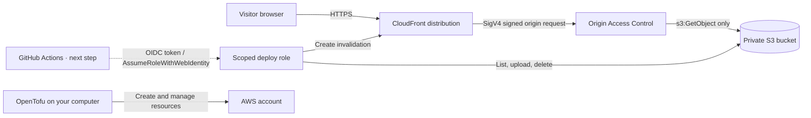

# AWS Static Website Case Study

A small, production-minded cloud project log hosted from a **private S3 bucket** and delivered through **Amazon CloudFront**. OpenTofu creates the AWS resources. The repository includes a GitHub Actions OIDC deployment pattern, but its AWS role and repository settings are a documented next step and are not configured yet.

> The source repository is public at [github.com/ZJXDL/aws-static-portfolio](https://github.com/ZJXDL/aws-static-portfolio). The workflow is prepared, but automatic deployments will start only after its AWS OIDC role and repository variables are configured. Until then, the workflow skips safely.

> The live page describes the deployed AWS project and contains no personal profile or CV details. Add other projects to `site/index.html` as they are built.

## Current deployment

- Site: https://d1650g44zju5p7.cloudfront.net
- S3 bucket: `cloud-portfolio-577500259963` (private; CloudFront is the public entry point)
- CloudFront distribution: `E2HQKB0TMNBJ3K`
- AWS region for the bucket: `us-east-1`

The infrastructure is deployed and the current `site/` files have been uploaded. The page is project-focused and does not require personal details.

## What this demonstrates

- Infrastructure as code with OpenTofu.
- A private S3 origin protected by CloudFront Origin Access Control (OAC).
- HTTPS for visitors, a CloudFront TLS policy, and security response headers.
- A documented GitHub Actions OIDC deployment pattern that can avoid storing long-lived AWS keys once configured.
- Infrastructure outputs, resource tagging, versioning, encryption, and an explicit teardown path.

## Architecture



The bucket has all S3 Block Public Access settings enabled. CloudFront is the only reader, and the bucket policy is scoped to this distribution's ARN. After the GitHub OIDC setup is completed, its deploy role can update site objects and clear this distribution's cache without changing infrastructure.

## Repository layout

```text
.
├── .github/workflows/deploy.yml   # Publish site on pushes to main
├── docs/                          # OIDC trust and deploy policy examples
├── infra/                         # OpenTofu configuration
└── site/                          # HTML, CSS, and JavaScript files
```

## Prerequisites

- An AWS account and an IAM identity allowed to create the listed resources.
- OpenTofu 1.6 or newer.
- AWS CLI configured locally for the account where you want to create the resources.
- A GitHub repository for this project.

The infrastructure creates an S3 bucket and a CloudFront distribution. A small portfolio will usually have low usage, but AWS charges depend on account plan, visitor geography, request count, and data transferred. Estimate your own usage with the [AWS Pricing Calculator](https://calculator.aws/) and current [CloudFront](https://aws.amazon.com/cloudfront/pricing/) and [S3](https://aws.amazon.com/s3/pricing/) pricing, and set a budget alert before deploying. This project deliberately uses the lower-cost `PriceClass_100` edge location set. No custom domain or paid certificate is required. S3 versioning retains previous object versions for rollback; the lifecycle rule expires noncurrent versions after 30 days.

## 1. Personalize the website

Edit `site/index.html` and replace:

- `Your Name` and the `YN` initials.
- `you@example.com`.
- `your-username` and the sample repository URL.
- The project text with your own work as you add it.

Keep the `site/` directory as the deployment root. The workflow publishes only files in that directory.

## 2. Create the AWS infrastructure

From the repository root:

```sh
cd infra
tofu init
tofu fmt -check
tofu validate
tofu plan
tofu apply
```

Review the plan, then approve `tofu apply`. Save the outputs:

```sh
tofu output site_url
tofu output bucket_name
tofu output distribution_id
```

The CloudFront distribution may take several minutes to finish deploying. The URL is available before that process completes, but the site may not load until CloudFront reports the distribution as deployed.

OpenTofu state contains identifiers and configuration details about your resources. Keep it private, do not commit it, and do not share it publicly. For this learning project it stays in the local `infra/terraform.tfstate` file, which `.gitignore` excludes.

## 3. Set up GitHub Actions access

Create a dedicated IAM role for this repository's deployment workflow. The policy files in `docs/` are already filled in for this AWS account and repository:

1. In IAM, ensure your account has the GitHub Actions OIDC identity provider `token.actions.githubusercontent.com`. If it is missing, create it with audience `sts.amazonaws.com`.
2. Create an IAM role named `GitHubPortfolioDeployRole` for web identity using that provider. Set its trust relationship to the contents of `docs/github-oidc-trust-policy.json`. This exact subject is limited to this repository's `main` branch and uses GitHub's immutable owner and repository IDs.
3. Attach an inline permissions policy to the role using `docs/github-deploy-policy.json`. This policy can upload or delete objects only in this project's bucket and invalidate only this CloudFront distribution. It cannot modify infrastructure.
4. Add these **repository variables** in GitHub under **Settings → Secrets and variables → Actions → Variables**:

   | Variable | Value |
   | --- | --- |
   | `AWS_ROLE_ARN` | ARN of the dedicated IAM deploy role |
   | `AWS_REGION` | Region used for the bucket, e.g. `us-east-1` |
   | `SITE_BUCKET` | OpenTofu `bucket_name` output |
   | `CLOUDFRONT_DISTRIBUTION_ID` | OpenTofu `distribution_id` output |

The workflow needs `id-token: write` to request a GitHub OIDC token. AWS then checks the token's audience and repository/branch subject against the IAM role trust policy. The credentials are short-lived. No AWS access key is stored in GitHub. The workflow skips while `AWS_ROLE_ARN` is empty; after adding the variables, run it once from the GitHub Actions tab to verify deployment.

## 4. Publish changes

Push a change to `site/` on the `main` branch. The workflow uploads the site files to the S3 bucket, removes stale files, and asks CloudFront to invalidate its cached paths. You can also start it manually from the GitHub Actions tab.

`aws s3 sync --delete` is safe here because the bucket is dedicated to this website. Do not reuse this bucket for unrelated data.

## Update the site locally

You can also publish from your computer after OpenTofu is applied:

```sh
aws s3 sync site/ "s3://$(cd infra && tofu output -raw bucket_name)/" --delete
aws cloudfront create-invalidation \
  --distribution-id "$(cd infra && tofu output -raw distribution_id)" \
  --paths '/*'
```

## Tear down

To delete the resources and empty the dedicated site bucket:

```sh
cd infra
tofu destroy
```

`force_destroy = true` lets OpenTofu remove the dedicated bucket and its contents. Do not point this configuration at a bucket containing anything you need to keep. The IAM OIDC provider and role described in the GitHub setup are created manually and are not deleted by OpenTofu; remove them separately if you no longer need them.

## Further reading

- [AWS CloudFront: restrict access to an S3 origin with OAC](https://docs.aws.amazon.com/AmazonCloudFront/latest/DeveloperGuide/private-content-restricting-access-to-s3.html)
- [AWS IAM: configure a role for the GitHub OIDC provider](https://docs.aws.amazon.com/IAM/latest/UserGuide/id_roles_create_for-idp_oidc.html)
- [GitHub: configure OIDC in AWS](https://docs.github.com/en/actions/how-tos/secure-your-work/security-harden-deployments/oidc-in-aws)
- [OpenTofu Registry: AWS provider](https://search.opentofu.org/provider/hashicorp/aws/latest)

## Tradeoffs and next steps

- This starter does not use a custom domain. Add one only after learning CloudFront's ACM certificate and DNS requirements.
- The deployment workflow syncs files on every matching push and invalidates `/*` for simplicity. A larger site could use versioned asset names and more targeted invalidations.
- OpenTofu state is local. A team project should use a remote, encrypted state backend with locking and access controls.
- The site uses system fonts and has no external font dependency. The CloudFront Content Security Policy still permits Google Fonts from an earlier design; remove those sources from `infra/main.tf` if keeping the page fully self-contained.
- Extend this project with a preview environment, automated infrastructure checks, a monitoring/alerting example, or a second project that exercises a different architecture.

See [`docs/INTERVIEW-WALKTHROUGH.md`](docs/INTERVIEW-WALKTHROUGH.md) for a concise explanation you can use in interviews.
