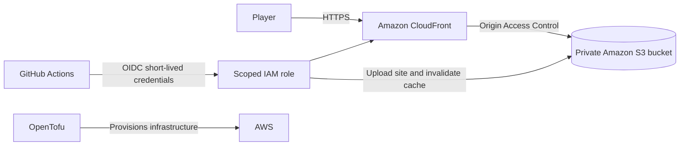

# Minefield

A classic Minesweeper game built with plain HTML, CSS, and JavaScript, and hosted on AWS. Choose a board, reveal safe squares, and flag the mines.

**[Play Minefield](https://d1650g44zju5p7.cloudfront.net)**

## The game

- Three classic boards: Beginner (9 × 9, 10 mines), Intermediate (16 × 16, 40 mines), and Expert (16 × 30, 99 mines).
- The first square and its neighbors are safe. Empty areas open automatically.
- Flag a square with the flag control, the `F` key, or right-click.
- Use the arrow keys to move around the board. Board controls include accessible labels for assistive technology.
- Timer, remaining-mine counter, and quick restart.

The game runs entirely in the browser. It has no account system, backend API, or external JavaScript dependencies.

## Architecture



OpenTofu provisions the S3 bucket, CloudFront distribution, origin access control, bucket policy, and response security headers. The bucket blocks public access; CloudFront is allowed to read objects through its distribution-specific policy. Visitors use HTTPS through CloudFront.

GitHub Actions publishes changes to `site/`. The workflow authenticates to AWS through GitHub's OIDC provider and a narrowly scoped IAM role, so the repository does not need long-lived AWS access keys. It syncs the site files to S3 and invalidates the CloudFront cache.

See [the architecture notes](docs/ARCHITECTURE.md) for request flow, deployment details, and design tradeoffs.

## Run locally

Serve the `site/` directory with any static web server. For example:

```sh
python3 -m http.server 8000 --directory site
```

Then open `http://localhost:8000`.

## Repository layout

```text
site/                    Game interface and browser logic
infra/                   OpenTofu AWS configuration
docs/                    Architecture notes and GitHub OIDC policy examples
.github/workflows/       GitHub Actions deployment workflow
```

## Infrastructure and deployment

The AWS stack is managed from `infra/` with OpenTofu. Review `infra/variables.tf` before applying; the configuration creates billable AWS resources. The bucket name is derived from the project name and AWS account ID.

The deployment workflow runs on pushes to `main` that change `site/` or the workflow file. It can also be started manually in GitHub Actions. It expects these GitHub repository variables:

| Variable | Purpose |
| --- | --- |
| `AWS_ROLE_ARN` | IAM role the workflow assumes through OIDC |
| `AWS_REGION` | Region used for the S3 bucket |
| `SITE_BUCKET` | Destination bucket for the site files |
| `CLOUDFRONT_DISTRIBUTION_ID` | Distribution whose cache is invalidated |

The example OIDC policy documents in `docs/` are scoped to this repository's deployment. Review and update the repository and AWS identifiers before reusing them elsewhere.

## Scope

This is a static, single-player implementation. Scores are not submitted to a server, and there is no global leaderboard or account system. The infrastructure demonstrates static content delivery and an automated AWS deployment workflow; it does not include an application backend.
