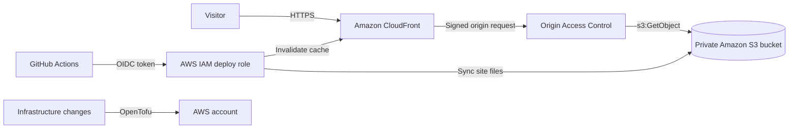

# AWS Static Site Delivery with OpenTofu

A static Minesweeper site deployed on AWS. The project focuses on the cloud infrastructure and delivery path: OpenTofu provisions a private Amazon S3 origin and Amazon CloudFront distribution, while GitHub Actions deploys site updates using GitHub OIDC and short-lived AWS credentials.

**[View the deployed site](https://d1650g44zju5p7.cloudfront.net)**

## Architecture



## AWS design

- **Private S3 origin:** S3 Block Public Access is enabled, ACLs are disabled through bucket ownership controls, and the bucket policy grants object reads only to this CloudFront distribution.
- **CloudFront with OAC:** Visitors access the site through CloudFront over HTTPS. CloudFront signs requests to the S3 REST origin with SigV4; the S3 website endpoint is not used.
- **Delivery security:** The distribution redirects HTTP to HTTPS, requires TLS 1.2 or newer, compresses responses, and attaches a response headers policy for browser security headers.
- **Storage safeguards:** S3 default encryption and versioning are enabled. A lifecycle rule expires noncurrent object versions after 30 days.
- **Workload identity for CI/CD:** GitHub Actions assumes a dedicated IAM role through OIDC. The role trust is restricted to this repository and branch, and its permissions cover publishing site files and invalidating this distribution. No long-lived AWS access keys are stored in GitHub.
- **Infrastructure as code:** OpenTofu defines the S3 bucket, CloudFront distribution, OAC, bucket policy, response headers policy, and outputs.

## Deployment flow

1. A push to `main` that changes `site/` starts the GitHub Actions workflow. It can also be started manually.
2. GitHub Actions requests an OIDC token. AWS validates its audience and repository/branch claims against the IAM role trust policy, then issues temporary credentials.
3. The workflow synchronizes `site/` to the bucket and requests a CloudFront invalidation.

The IAM OIDC provider and deploy role are configured separately from the OpenTofu stack. Example trust and permission policies are in `docs/`; review their repository and AWS identifiers before adapting them.

The workflow uses these GitHub repository variables:

| Variable | Purpose |
| --- | --- |
| `AWS_ROLE_ARN` | IAM role assumed through OIDC |
| `AWS_REGION` | Region for the S3 bucket |
| `SITE_BUCKET` | Destination bucket for site files |
| `CLOUDFRONT_DISTRIBUTION_ID` | Distribution whose cache is invalidated |

## Infrastructure lifecycle

OpenTofu configuration is in `infra/`. To review or apply it, run from that directory:

```sh
tofu init
tofu plan
tofu apply
```

The current state file is local and excluded by `.gitignore`; protect it as sensitive infrastructure data. A team deployment should use a remote backend with encryption, locking, and access controls. The S3 bucket name includes the AWS account ID to keep it unique.

The stack creates billable AWS resources. The CloudFront distribution uses `PriceClass_100`, the default CloudFront certificate, and no custom domain. The bucket is dedicated to this site, and `force_destroy` is enabled for teardown; do not store unrelated files in it.

## Repository layout

```text
infra/                   OpenTofu AWS configuration
site/                    Static Minesweeper application
docs/                    Architecture notes and OIDC policy examples
.github/workflows/       GitHub Actions deployment workflow
```

The application is a static, single-player browser game. Themes, hazard styles, and personal records are saved in the browser; there is no backend, database, user account system, or shared leaderboard. The AWS implementation demonstrates infrastructure as code, private origin delivery, and identity-based CI/CD for a static workload.
